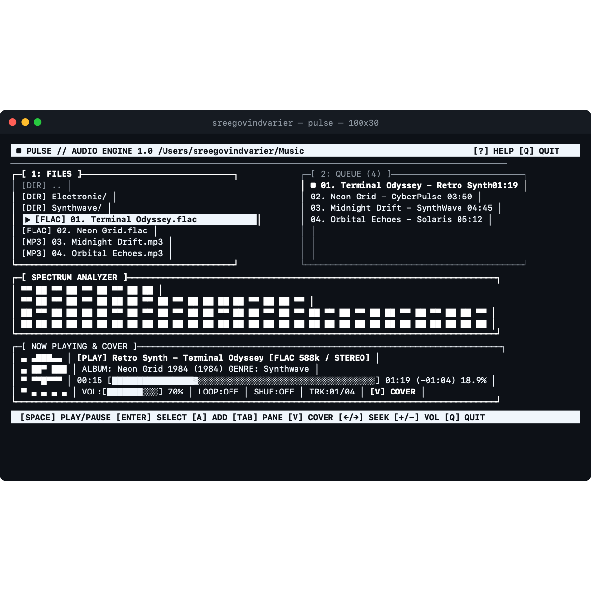

# Pulse CLI

<p align="center">
  <a href="https://github.com/pookie421/MusicCLI"></a>
  <a href="https://github.com/pookie421/MusicCLI"></a>
  <a href="https://www.python.org"></a>
  <a href="LICENSE"></a>
  <a href="https://github.com/pookie421/MusicCLI"></a>
  <a href="https://github.com/pookie421/MusicCLI"></a>
  <a href="https://github.com/pookie421/MusicCLI"></a>
</p>

<p align="center">
  A high-performance, 1-bit monochrome terminal MP3 & FLAC music player for macOS with real-time discrete hardware spectrum analysis, embedded album cover art rendering, and zero pseudo-GUI bloat.
</p>

<p align="center">
  
</p>

---

## Features

- **Lossless & Lossy Playback**: Native CoreAudio playback for both **FLAC** (lossless) and **MP3** files.
- **Embedded Album Cover Art**:
  - **In-Terminal 1-Bit Pixel Art**: Real-time Floyd-Steinberg dithered album cover thumbnails embedded directly in the player telemetry panel.
  - **Full-Resolution macOS Preview (`V` key)**: Instant one-keystroke extraction to view the crystal-clear original cover artwork in macOS Preview.
  - **Expanded Pixel Art Modal**: Full-screen high-resolution monochrome cover art viewer inside the terminal.
- **Pure 1-Bit Monochrome Design**: Authentic high-contrast black-and-white curses aesthetics with zero ANSI color slop or pseudo-GUI web bloat.
- **Live Hardware Spectrum Analyzer**: Real-time frequency response visualization with peak-hold dot indicators at 25 FPS.
- **Vim & POSIX Keybindings**: Seamless navigation with `hjkl`, `Space`, and standard terminal shortcuts.
- **Full Library Explorer & Queue Management**: Interactive file browser, search filtering (`/`), recursive folder enqueueing (`A`), and shuffle/repeat modes.

---

## Quickstart

### Automated Install (Recommended)

Run the one-line deployment script to set up an isolated environment and link `pulse` to your path:

```bash
git clone https://github.com/pookie421/MusicCLI.git
cd MusicCLI
./install.sh
```

Ensure `~/.local/bin` is in your shell path (add to `~/.zshrc` if not present):
```bash
export PATH="$HOME/.local/bin:$PATH"
```

Then launch the player from any directory:
```bash
pulse
```

---

## Usage

Pulse CLI accepts an optional file or directory path as an argument:

```bash
# Launch player in ~/Music (or current working directory)
pulse

# Open directly into a specific folder
pulse ~/Music/Electronic

# Play a FLAC or MP3 file immediately
pulse song.flac
pulse song.mp3

# Display argument options
pulse --help
```

---

## Keyboard Controls Reference

The application operates entirely within the terminal using standard POSIX and Vim-style keybindings:

| Action | Keybinding |
| :--- | :--- |
| **Play / Pause** | `Space` |
| **Seek Backward / Forward** | `Left` / `Right` (or `,` / `.`) `±5s` |
| **Volume Up / Down** | `+` / `-` (or `]` / `[`) `±5%` |
| **Mute / Unmute** | `M` |
| **Next / Previous Track** | `N` / `P` |
| **Cycle Repeat Mode** | `R` *(Off → Track → Queue)* |
| **Toggle Shuffle Mode** | `S` *(On / Off)* |
| **View Cover Art** | `V` *(Opens hi-res in Preview + expanded terminal modal)* |
| **Navigate Selection** | `j` / `k` (or `Up` / `Down`) |
| **Open Folder / Play File** | `Enter` (or `l`) |
| **Ascend to Parent Folder** | `Backspace` (or `h`) |
| **Add to Playlist Queue** | `A` *(Enqueues file or entire directory)* |
| **Switch Focus Panes** | `Tab` *(Files `[1]` ↔ Queue `[2]`)* |
| **Search Filter** | `/` *(Type to filter, `Enter` to confirm, `Esc` to clear)* |
| **Remove from Queue** | `D` / `X` |
| **Clear Queue** | `C` |
| **Internal Help Screen** | `?` |
| **Quit** | `Q` |

---

## System Architecture

```
+-------------------------------------------------------------------------------+
|                      POSIX Terminal Display Engine                            |
|                  (Curses Double-Buffered Grid: 25 Hz)                         |
|                                                                               |
|  +-------------------------------------+  +--------------------------------+  |
|  |  [1: FILES]                         |  |  [2: QUEUE]                    |  |
|  |  - Direct Inode Navigation (../)    |  |  - Sequential / Shuffle Model  |  |
|  |  - MP3 & FLAC Filtering             |  |  - Direct Index Traversal      |  |
|  |  - Instant Substring Search (/)     |  |  - Track Scrubber Accounting   |  |
|  +-------------------------------------+  +--------------------------------+  |
|                                                                               |
|  +-------------------------------------------------------------------------+  |
|  |  Dynamic Spectral Equalizer (Real-Time Unicode Discrete Block Array)    |  |
|  +-------------------------------------------------------------------------+  |
|  |  1-Bit Album Cover Thumbnail | Now Playing Telemetry & Scrubber         |  |
|  +-------------------------------------------------------------------------+  |
+-------------------------------------------------------------------------------+
                                    |        ^
                       State Events |        | PCM Energy Levels
                                    v        |
+-------------------------------------------------------------------------------+
|                             Core Audio Engine                                 |
|                     (miniaudio / Darwin CoreAudio Host)                       |
|                                                                               |
|   +-------------------+    +--------------------+    +--------------------+   |
|   | FLAC / MP3 Stream | -> | 44.1 kHz Stereo    | -> | CoreAudio Output   |   |
|   | Decoder           |    | PCM Circular Ring  |    | Buffer (1024 smp)  |   |
|   +-------------------+    +--------------------+    +--------------------+   |
+-------------------------------------------------------------------------------+
```

### Signal Processing Pipeline
1. **Decode Phase**: Incoming FLAC and MP3 bitstreams are decoded into contiguous signed 16-bit interleaved PCM normalized to a constant sampling frequency of 44,100 Hz (Stereo).
2. **Buffering & Delivery**: An audio generator supplies 1024-frame chunks to the native macOS CoreAudio bus via `miniaudio`.
3. **Sub-Millisecond Seeking**: Temporal seek offsets map directly to memory indices via:
   $$\text{Frame Offset} = \text{Target Time (seconds)} \times 44100$$
4. **Spectral Analysis**: Real-time amplitude metrics are processed at 25 Hz and rendered as high-contrast discrete pixel blocks with peak-hold indicators.
5. **Cover Art Synthesis**: Embedded metadata (FLAC Picture blocks & ID3 APIC frames) are dynamically resampled and converted to 1-bit Floyd-Steinberg dithered pixel art using half-block Unicode characters (`▀`, `▄`, `█`, ` `).

---

## Manual Setup & Development

```bash
git clone https://github.com/pookie421/MusicCLI.git
cd MusicCLI
python3 -m venv .venv
source .venv/bin/activate
pip install -e .
```

### Project Structure
```
MusicCLI/
|-- pulse/
|   |-- __init__.py           # Package version definition
|   |-- __main__.py          # CLI entry point and argument parsing
|   |-- app.py               # 1-bit monochrome curses interface loop
|   |-- audio.py             # CoreAudio driver and PCM streaming
|   |-- metadata.py          # FLAC/ID3 metadata & 1-bit cover art engine
|   `-- queue_manager.py     # Deterministic and randomized queue models
|-- docs/
|   |-- preview.png          # High-resolution UI preview
|   `-- preview.svg          # Vector terminal graphic
|-- pyproject.toml           # PEP 621 package metadata
|-- requirements.txt         # Dependencies (miniaudio, mutagen, Pillow)
|-- install.sh               # Local deployment script
|-- LICENSE                  # MIT License
`-- README.md                # System documentation
```

---

## Contributing

Contributions that optimize performance or enhance audio metadata parsing are welcomed:
1. Fork the repository.
2. Create your feature branch (`git checkout -b feature/enhancement`).
3. Commit your changes (`git commit -m 'feat: add feature'`).
4. Push to the branch (`git push origin feature/enhancement`).
5. Open a Pull Request.

---

## License

This project is licensed under the MIT License. See [LICENSE](LICENSE) for details.
